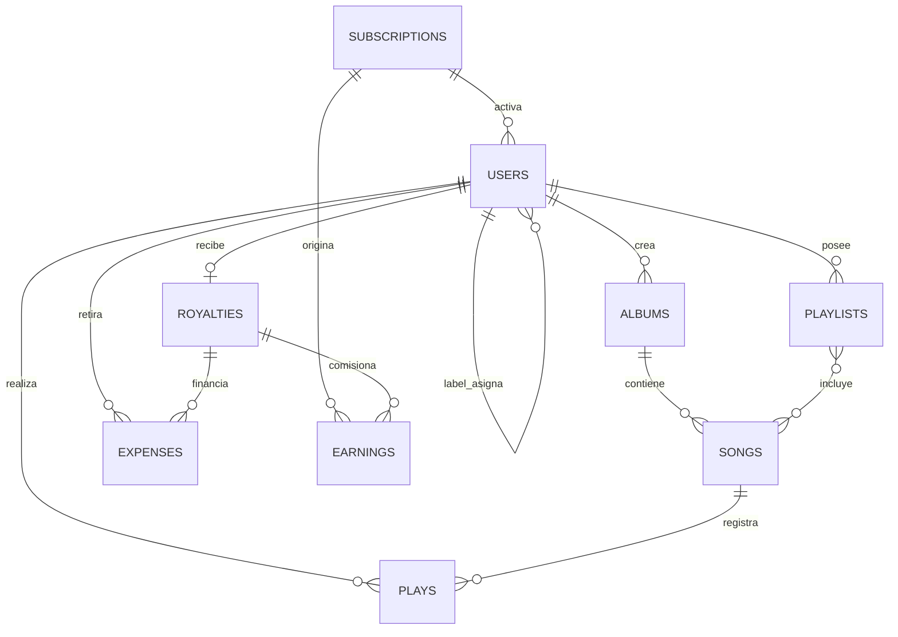

# Fase 0: línea base de migración

**Estado:** línea base local completada; perfilado de datos reales pendiente.
**Fecha de revisión:** 2026-10-14.
**Alcance de esta evidencia:** migraciones, modelos, controladores, rutas, seeders, configuración versionada y pruebas presentes en el repositorio. No se inspeccionó una base de datos con datos reales.

## Fuente relacional y entorno

| Elemento | Hallazgo | Estado |
| --- | --- | --- |
| Conexión predeterminada en código | `config/database.php` usa `DB_CONNECTION` con respaldo `sqlite`. | Confirmado en código; el entorno local lo sobrescribe. |
| Fuente relacional oficial | MySQL, confirmado para la migración. | Confirmado por el equipo. |
| Entorno Docker local | `mysql:8.4` expone MySQL en el puerto 3306; MongoDB se publica en 27018 por conflicto con otra instancia local; la aplicación alcanza ambos por sus nombres de servicio. | Preparado para validación. |
| Archivo de ejemplo | `.env.example` aún establece `DB_CONNECTION=sqlite`. | Pendiente de alinear en una mejora documental posterior. |
| Documentación de arranque | El README describe configuración MySQL. | Coherente con la fuente oficial. |
| Sesiones, cache y colas | `.env.example` y la configuración usan el driver `database`. | Deben mantenerse fuera de la primera migración de dominio. |
| Dependencia MongoDB | `composer.json` no declara un driver MongoDB. | Pendiente para la fase 2. |

La fuente oficial para la carga inicial es MySQL. Antes de extraer información se debe registrar: versión, nombre de base, tamaño, conteo por tabla, tasa de escritura y respaldo consistente. La conexión de MongoDB seguirá reservada para la fase 2.

La definición de Docker contiene MySQL, MongoDB y la aplicación, y fue validada con `docker compose config --quiet`. El entorno local ya fue levantado y verificado; la instancia real que se migrará aún debe conectarse por separado.

### Resultado de la ejecución local con Docker

La configuración se corrigió y se verificó el 2026-10-15:

- `melodic-mysql` está saludable en `localhost:3306`.
- `melodic-mongodb` está saludable en `localhost:27018`; dentro de Docker continúa disponible como `mongodb:27017`.
- `melodic-app` está activo en `http://localhost:8000` y la ruta `/` respondió `HTTP 200`.
- Las 10 migraciones relacionales terminaron correctamente en MySQL.
- Las extensiones PHP `PDO`, `pdo_mysql`, `mbstring`, `bcmath` y `zip` están disponibles.
- Los seeders crearon 4 usuarios y 2 suscripciones. Álbumes, canciones, reproducciones, playlists y movimientos financieros quedaron en cero.
- MongoDB fue levantado, pero no se escribieron colecciones de dominio.

La primera ejecución de Laravel intentó migrar antes de que MySQL aceptara conexiones y registró `SQLSTATE[HY000] [2002] Connection refused`; el contenedor reintentó el arranque y completó las migraciones. Este comportamiento debe sustituirse por un mecanismo de espera/reintento más explícito antes de usar el entorno como referencia de despliegue.

## Inventario del modelo relacional

### Tablas del dominio

| Tabla | Identificador y datos principales | Relaciones y reglas observadas |
| --- | --- | --- |
| `subscriptions` | `id` entero; `name`, `cost decimal(10,2)`, `months`, timestamps. | Plan referenciado por `users.subscription_id` y `earnings.subscription`. |
| `users` | `user_id` UUID; `username`, `email` único, contraseña, `role`, `is_suscribed`, `fin_subscription`, `subscription_id`, `path`, `label`, timestamps. | `subscription_id → subscriptions.id`; `label → users.user_id` para artistas administrados por un label. Propietario de álbumes y playlists; receptor de regalías y retiros. |
| `albums` | `album_id` entero; `title`, `path`, `user_id`, timestamps. | `user_id → users.user_id`; contiene canciones. |
| `songs` | `song_id` entero; `name`, `length`, `plays`, `file_path`, `image_path`, `album_id`, timestamps. | `album_id → albums.album_id`; participa en playlists y reproducciones. |
| `plays` | `play_id` entero; `song_id`, `user_id`, timestamps. | Registra relación canción–usuario, pero el flujo actual de reproducción no inserta en esta tabla. |
| `playlists` | `playlist_id` entero; `name`, `description`, `path`, `user_id`, timestamps. | `user_id → users.user_id`; contiene canciones mediante `playlist_song`. |
| `playlist_song` | Sin clave primaria declarada; `song_id`, `playlist_id`, timestamps. | Muchos a muchos, cascada al borrar canción o playlist. No hay restricción única que impida duplicados. |
| `royalties` | `royalties_id` entero; `amount decimal(13,2)`, `last_payment`, `recipient_id`, timestamps. | `recipient_id` es único y referencia a `users.user_id`; representa un saldo por destinatario. |
| `expenses` | `expense_id` entero; `amount decimal(13,2)`, `state`, `at`, `from`, `user_id`, timestamps. | Retiro del usuario; `from → royalties.royalties_id`; `user_id → users.user_id`. |
| `earnings` | `earning_id` entero; `amount decimal(13,2)`, `state`, `at`, `subscription`, `comision`, timestamps. | Ingreso por suscripción o comisión de un retiro; referencias a suscripción o regalía. |

### Tablas de infraestructura Laravel

| Tabla | Uso actual | Decisión inicial |
| --- | --- | --- |
| `cache`, `cache_locks` | Cache y bloqueos con driver `database`. | Mantener en el almacén actual durante la migración del dominio. |
| `sessions` | Sesiones con driver `database`. | Mantener para preservar autenticación durante convivencia. |
| `jobs`, `job_batches`, `failed_jobs` | Colas con driver `database`. | Mantener hasta contar con un diseño operativo independiente. |
| `password_reset_tokens` | Restablecimiento de contraseña. | Mantener con autenticación actual hasta la fase de identidad. |

## Relaciones y consultas que definen el diseño posterior

Las consultas observadas que deberán validarse con datos y `explain()` durante la fase 1 son:

1. Canciones aleatorias con álbum y artista para el dashboard de usuario.
2. Álbumes de un artista con conteo de canciones.
3. Playlists de un usuario con conteo, detalle de canciones y exclusión de canciones ya agregadas.
4. Búsqueda de canciones por nombre o nombre de artista.
5. Artistas de un label con álbumes, canciones y suma de reproducciones.
6. Saldo de regalías y últimos cinco retiros por usuario.
7. Totales de ingresos y gastos, ingresos de los últimos 30 días y agregación mensual de seis meses.

## Matriz de casos de uso

| Caso de uso | Ruta o entrada | Lecturas | Escrituras | Invariante a preservar |
| --- | --- | --- | --- | --- |
| Registro e inicio de sesión | `/register`, `/login` | Usuario por correo. | Usuario y sesión. | Correo único, contraseña hasheada y UUID estable. |
| Crear label o artista | `/admin/create-label`, `/label/create-artist` | Usuario autenticado y rol. | Usuario con rol y, para artista, referencia al label. | Solo el rol autorizado crea la cuenta; `label` referencia un usuario existente. |
| Comprar suscripción | `POST /premium` | Plan y vigencia del usuario. | Ingreso y actualización del usuario. | Fecha final calculada desde la vigencia actual o la fecha presente; no debe perderse el ingreso. |
| Crear álbum | `POST /album` | Artista autenticado. | Álbum y archivo de portada opcional. | El álbum pertenece al artista autenticado. |
| Subir canción | `POST /song` | Álbum opcional y artista autenticado. | Archivo, álbum automático si falta, canción. | La canción debe asociarse a un álbum del flujo; conservar rutas de Storage. |
| Explorar catálogo | `GET /explore` | Canción, álbum y artista. | Ninguna. | Coincidencia por canción o artista y orden reciente si hay búsqueda. |
| Reproducir canción | `POST /song/{song}/play` | Canción, álbum, artista y saldo del destinatario. | Incremento de `plays` y regalía. | Cada reproducción aceptada incrementa contador y saldo una vez. |
| Crear playlist | `POST /playlist` | Usuario autenticado. | Playlist y portada opcional. | La playlist pertenece al usuario. |
| Consultar o añadir canción a playlist | `GET /playlist/{playlist}`, `POST /playlist/{playlist}/add-song` | Propietario, canciones existentes y catálogo. | Relación playlist–canción. | Solo el dueño modifica; no debe repetirse una canción. |
| Retirar regalías | `POST /withdraw`, `POST /label/withdraw` | Saldo de regalías. | Gasto, ingreso de comisión y saldo a cero. | Las tres mutaciones son atómicas y no se duplican ante reintento. |
| Dashboards | Rutas `/dashboard/*` | Catálogo, saldos, retiros, movimientos y agregados. | Ninguna. | Totales y agregados coherentes con los movimientos fuente. |

## Discrepancias que requieren decisión antes de diseñar colecciones

| Tema | Evidencia | Decisión requerida |
| --- | --- | --- |
| Fuente de datos | MySQL es la fuente oficial, mientras que `config/database.php` y `.env.example` conservan SQLite como respaldo/ejemplo. | Tomar y validar un respaldo MySQL antes de cualquier carga a MongoDB. |
| Reproducciones | Existe `plays`, pero `registerPlay` solo actualiza `songs.plays` y `royalties`. | Definir si `plays` será auditoría, si el contador será la única fuente o si ambos coexistirán. |
| Duplicados en playlists | El controlador verifica antes de insertar, pero la tabla pivote carece de unicidad compuesta. | Definir una garantía de unicidad en la nueva persistencia y reconciliar duplicados heredados. |
| Propiedad de álbum en subida | La validación confirma que existe el álbum, pero no que pertenezca al artista autenticado. | Decidir y probar la regla de autorización que debe preservarse o corregirse. |
| Retiros duplicados | Hay tres implementaciones similares de retiro; no usan una clave de idempotencia. | Definir `operation_id` y la semántica ante reintentos/concurrencia. |
| Campos y timestamps | `Album` deshabilita timestamps aunque la tabla los declara; algunos campos no aparecen en `$fillable`. | Establecer el contrato de datos antes de la extracción. |
| Nombres heredados | `is_suscribed`, `fin_subscription`, `comision` y `from`. | Conservarlos temporalmente en la transformación o aprobar nombres nuevos con mapeo explícito. |

## Salidas pendientes para cerrar la fase 0

1. Conectar la instancia MySQL que contiene los datos reales y generar el reporte de perfilado: conteos, nulos, huérfanos, duplicados, tamaños y distribución de fechas.
2. Crear un respaldo consistente de esa instancia y ensayar su restauración en un entorno aislado.
3. Instalar las dependencias del proyecto y ejecutar `composer test`. El intento del 2026-10-14 no inició la suite porque falta `vendor/autoload.php`; además, la suite actual solo contiene pruebas de ejemplo.
4. Línea base de latencia y planes de ejecución de las consultas críticas.
5. Resoluciones aprobadas para las discrepancias de esta página.

Al completarse estas salidas, la fase 1 podrá decidir documentos, referencias, índices e identificadores sobre evidencia de uso y volumen reales.
