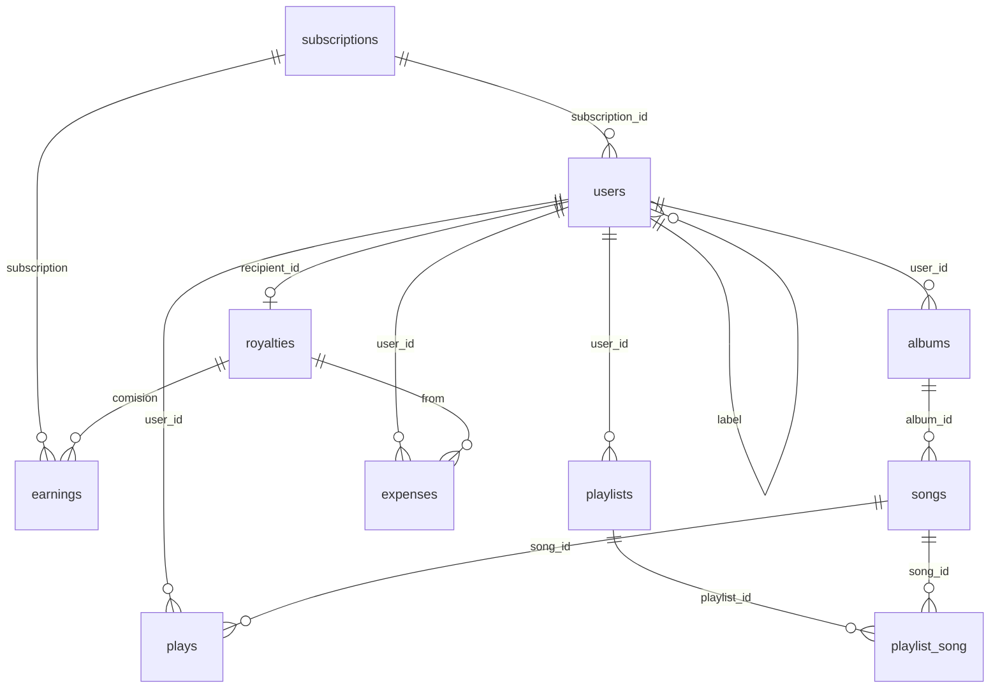

# Inventario relacional y catálogo de consultas

Fuente: `database/migrations`, `app/Models` y `app/Http/Controllers` en `dev` (2026-10-19). La base de origen para la carga es MySQL (ver `docs/migracion-mongodb/FASE-0-LINEA-BASE.md`); localmente se usa SQLite con el mismo esquema.

## Tablas de dominio

| Tabla | PK | Columnas | Relaciones | Notas del código |
|---|---|---|---|---|
| `subscriptions` | `id` int | `name`, `cost` decimal(10,2), `months` tinyint | 1:N `users.subscription_id`, 1:N `earnings.subscription` | Catálogo; lo llena `SubscriptionSeeder` |
| `users` | `user_id` UUID | `username`, `email` único, `password`, `role` (`user`, `artist`, `label`, `admin`), `is_suscribed`, `fin_subscription` date, `path`, `email_verified_at`, `remember_token` | `subscription_id` → `subscriptions`; `label` → `users` (autorrelación) | El UUID lo genera el modelo al crear |
| `albums` | `album_id` int | `title`, `path` | `user_id` → `users` | `Album::$timestamps = false`: `created_at` y `updated_at` quedan en `null` |
| `songs` | `song_id` int | `name`, `length` (siempre 0), `plays` contador, `file_path`, `image_path` | `album_id` → `albums` | `SongController@store` no guarda `length` |
| `playlists` | `playlist_id` int | `name`, `description` (nunca se escribe), `path` | `user_id` → `users` | |
| `playlist_song` | sin PK | `timestamps` | N:M `playlists`–`songs`, `cascade` | `attach()` no llena los timestamps |
| `plays` | `play_id` int | `timestamps` | `song_id`, `user_id` | Ningún código la escribe |
| `royalties` | `royalties_id` int | `amount` decimal(13,2), `last_payment` | `recipient_id` → `users`, único | Un monedero por artista independiente o label |
| `earnings` | `earning_id` int | `amount` decimal(13,2), `state`, `at` | `subscription` → `subscriptions`; `comision` → `royalties` | Solo inserción |
| `expenses` | `expense_id` int | `amount` decimal(13,2), `state`, `at` | `from` → `royalties`; `user_id` → `users` | Solo inserción |

Tablas de framework que no se migran en este sprint: `sessions`, `cache`, `cache_locks`, `jobs`, `job_batches`, `failed_jobs`, `password_reset_tokens`, `migrations`.

## Diagrama entidad-relación

## Consultas por controlador

Frecuencia estimada: **muy alta** (cada reproducción), **alta** (cada visita de un oyente), **media** (paneles de artista y label), **baja** (operaciones puntuales).

| Controlador | Ruta | Operación | Tablas | Frecuencia |
|---|---|---|---|---|
| `SongController@registerPlay` | `POST /song/{song}/play` | Transacción: `plays + 1`; `firstOrCreate` de la regalía del artista o de su label y `amount + 0.15` | `songs`, `albums`, `users`, `royalties` | Muy alta |
| `DashboardController@user` | `GET /dashboard/user` | 6 canciones al azar con `album.artist`; playlists del usuario con `withCount('songs')` | `songs`, `albums`, `users`, `playlists`, `playlist_song` | Alta |
| `DashboardController@explore` | `GET /explore` | `name LIKE %q%` o `username LIKE %q%` vía `album.artist`; sin `q`, todas por `created_at` desc | `songs`, `albums`, `users` | Alta |
| `PlaylistController@show` | `GET /playlist/{playlist}` | Canciones de la playlist; búsqueda `LIKE` de canciones que no están en ella (`whereNotIn`) | `playlists`, `playlist_song`, `songs`, `albums`, `users` | Alta |
| `PlaylistController@addSong` | `POST /playlist/{playlist}/add-song` | Comprueba si ya existe y hace `attach` | `playlist_song` | Media |
| `PlaylistController@index` | `GET /playlists` | Playlists del usuario con conteo, por `created_at` desc | `playlists`, `playlist_song` | Media |
| `PlaylistController@store` | `POST /playlist` | Inserta playlist | `playlists` | Baja |
| `DashboardController@artist` | `GET /dashboard/artist` | Álbumes del artista con conteo de canciones; saldo y últimos 5 retiros si no tiene label | `albums`, `songs`, `royalties`, `expenses` | Media |
| `DashboardController@label` | `GET /dashboard/label` | Artistas del label con álbumes y canciones; suma de `plays`; saldo y últimos 5 retiros | `users`, `albums`, `songs`, `royalties`, `expenses` | Media |
| `AlbumController@show` | `GET /album/{album}` | Álbum con artista y canciones | `albums`, `users`, `songs` | Media |
| `AlbumController@store` | `POST /album` | Inserta álbum | `albums` | Baja |
| `SongController@store` | `POST /song` | Crea el álbum si no viene y la canción, sin transacción | `albums`, `songs` | Baja |
| `WalletController@withdraw` | `POST /withdraw` | Transacción: lee saldo, `expense` 70 %, `earning` 30 %, saldo a 0 | `royalties`, `expenses`, `earnings` | Baja |
| `LabelController@withdraw` | `POST /label/withdraw` | Igual que el anterior, sin `from` ni `comision` | `royalties`, `expenses`, `earnings` | Baja |
| `SubscriptionController@store` | `POST /premium` | Inserta `earning` y actualiza el usuario, sin transacción | `subscriptions`, `earnings`, `users` | Baja |
| `SubscriptionController@index` | `GET /premium` | Todos los planes | `subscriptions` | Baja |
| `AdminController@index` | `GET /dashboard/admin` | `SUM` de ingresos y egresos; ingresos por mes de 6 meses con `DATE_FORMAT`; ingresos de 30 días; últimos 10 labels | `earnings`, `expenses`, `users` | Baja |
| `AdminController@storeLabel` | `POST /admin/create-label` | Inserta usuario `label` | `users` | Baja |
| `LabelController@storeArtist` | `POST /label/create-artist` | Inserta usuario `artist` con `label` | `users` | Baja |
| `RegisterController@store` | `POST /register` | Inserta usuario `user` o `artist` | `users` | Baja |
| `LoginController@login` | `POST /login` | Busca por `email` | `users` | Media |
| Middleware `subscribed` | Rutas de oyente | Lee y, si venció, limpia la suscripción | `users` | Alta |

## Hallazgos

Revisión de la sección 1.4 de `scrum.md` contra el código actual.

| # | Hallazgo | Estado |
|---|---|---|
| 1 | El registro asignaba el rol desde el formulario | Resuelto en E2-T15 |
| 2 | Secretos en `compose.yaml` y MongoDB publicado | Resuelto en E2-T18 y E4-T21 |
| 3 | Condiciones de carrera en reproducir y retirar | Resuelto en E1-T11: `$inc` y `findOneAndUpdate` dentro de una transacción |
| 4 | Tres implementaciones del retiro; `DashboardController::withdraw` sin ruta y la de label sin `from` ni `comision` | Resuelto en E1-T11: un solo `WalletService` |
| 5 | `DATE_FORMAT` rompe el dashboard de admin en SQLite | Vigente; E1-T12. La prueba queda incompleta en SQLite |
| 6 | Montos calculados con `float` | Resuelto en E1-T11: bcmath y `Decimal128` |
| 7 | `plays` nunca se escribe | Vigente; backlog C01 |
| 8 | El `down()` de `create_songs_table` borra `songs` antes que `plays` | Vigente; backlog C04 |
| 9 | `SongController@store` sin transacción | Vigente; E1-T09 |
| 10 | No había pruebas | Resuelto en E1-T06 |
| 11 | `albums` y `playlist_song` no guardan timestamps | Nuevo. La carga debe aceptar `created_at` nulo |
